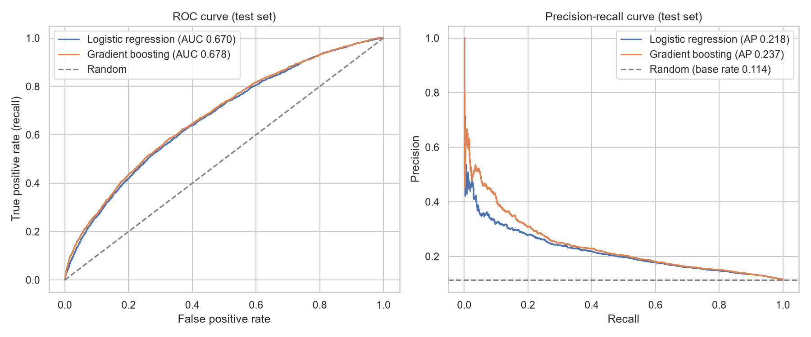
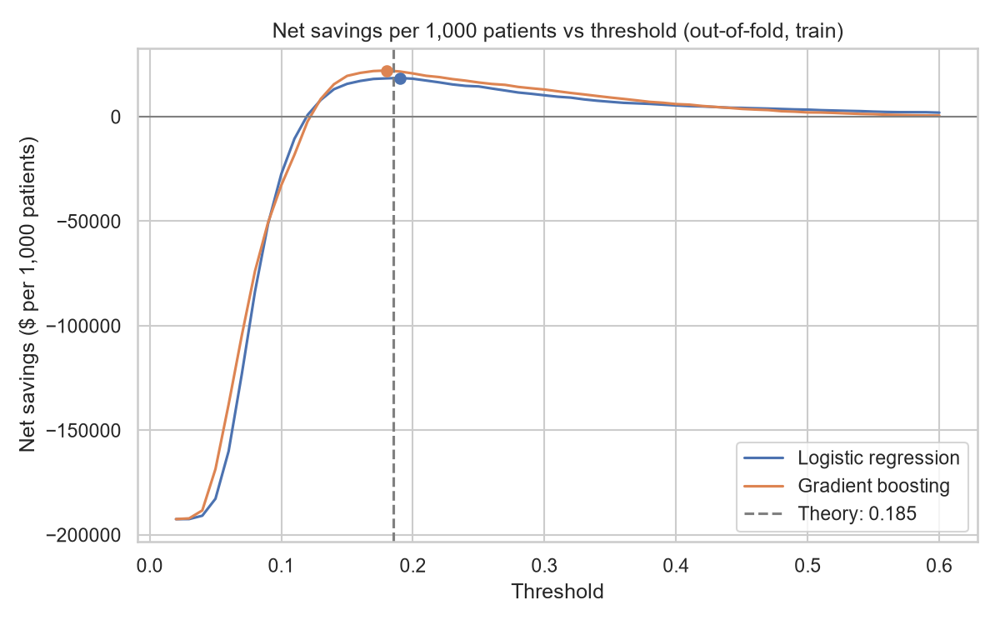
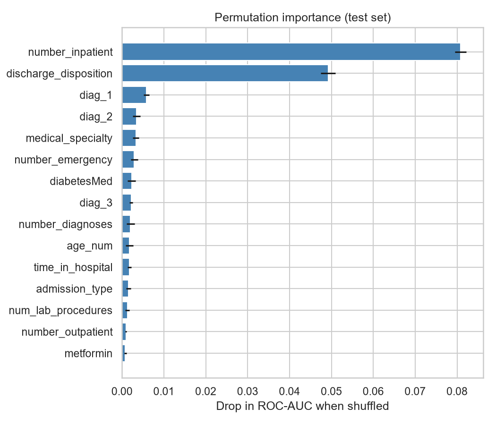
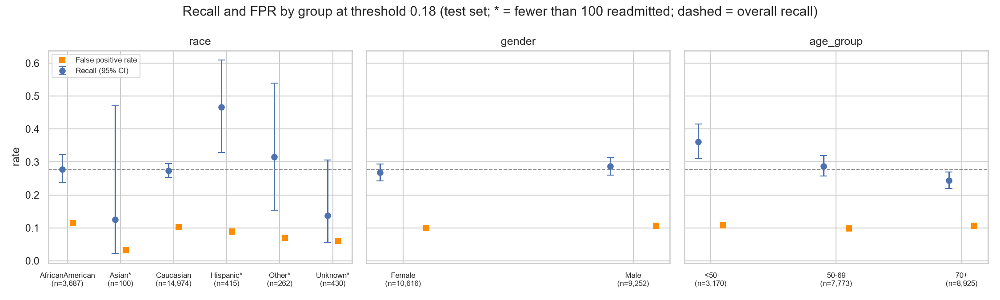

# Hospital Readmission Risk: Who Needs Follow-Up Care?

Predicting which diabetic patients will be readmitted to hospital within 30 days, so a hospital can target follow-up calls and visits where they save the most money and the most readmissions.

**Headline result:** a gradient boosting model, used with a cost-based decision threshold, flags **12.3%** of discharged patients and catches **27.7%** of 30-day readmissions. One in four flagged patients is actually readmitted (precision **25.7%**), compared with one in nine picked at random (11.4%). Under stated cost assumptions, that works out to an estimated **net saving of ~$23,700 per 1,000 discharges**. Flagging every patient instead would *lose* ~$192,500 per 1,000.



---

## The question

About 1 in 9 diabetic patients in this data comes back to hospital within 30 days. Follow-up care (a nurse call, a home visit) can prevent some of these readmissions, but it costs money, so it can't go to everyone. The project answers:

1. Can we rank patients by readmission risk better than chance?
2. Where should the cut-off be, given what a readmission and a follow-up actually cost?
3. Which factors drive the predictions?
4. Does the model work equally well across race, gender and age?

## Data

- **Source:** [UCI Machine Learning Repository: Diabetes 130-US Hospitals for Years 1999-2008](https://archive.ics.uci.edu/dataset/296/diabetes+130-us+hospitals+for+years+1999-2008) (CC BY 4.0).
  Clore, J., Cios, K., DeShazo, J., & Strack, B. (2014). DOI: [10.24432/C5230J](https://doi.org/10.24432/C5230J)
- **Size:** 101,766 hospital encounters, 50 columns, 71,518 unique patients, from 130 US hospitals.
- **Target:** `readmitted = "<30"` -> 1, otherwise 0. **Base rate 11.16%** (11,357 encounters).
- **Repeat patients:** 23.5% of patients had more than one stay, and their rows make up **46.2%** of the data. A random train/test split would let the model "recognise" the same patient in both sets, so the split is grouped by patient.

## Approach

| Notebook | What it does |
|---|---|
| [`01_explore`](notebooks/01_explore.ipynb) | Shape, missing values, target distribution, repeat patients, decoding the ID columns |
| [`02_clean`](notebooks/02_clean.ipynb) | Removes death/hospice discharges, handles missing values, groups ~700 diagnosis codes into 9 groups, builds the binary target |
| [`03_model`](notebooks/03_model.ipynb) | Patient-grouped train/test split, logistic regression baseline, gradient boosting, ROC-AUC and PR-AUC |
| [`04_threshold`](notebooks/04_threshold.ipynb) | Calibration check, cost-based decision threshold, sensitivity analysis |
| [`05_explain_fairness`](notebooks/05_explain_fairness.ipynb) | Permutation importance, SHAP, recall and false-positive rate by race, gender and age |

### Key cleaning decisions

- **Removed 2,423 encounters that ended in death or hospice.** These patients can't be readmitted (or rarely are) for reasons unrelated to care quality. Sanity check: the 1,652 patients who died had exactly 0 readmissions.
- **Dropped `weight` (97% missing) and `payer_code` (40% missing).** Payer type is also an insurance/income proxy that shouldn't drive who gets care.
- **Kept "test not done" as information.** In `A1Cresult` and `max_glu_serum`, the value `"None"` means the test wasn't performed. pandas' default CSV reader silently turns `"None"` into missing data, which would have erased 96,420 values in `max_glu_serum` alone. The data is read with `keep_default_na=False`, and the value is renamed to `"NotTested"`.
- **Treated ID codes as labels, not numbers.** Admission and discharge codes were decoded with `IDS_mapping.csv` into readable categories.
- **Result:** 99,340 rows x 34 columns, 69,987 patients, 0 missing values, base rate 11.39%.

## Results

### 1. Ranking patients by risk (test set: 19,868 encounters, 14,018 patients, none of them seen in training)

| Model | CV ROC-AUC (train, 5 grouped folds) | Test ROC-AUC | Test PR-AUC | PR-AUC vs random |
|---|---|---|---|---|
| Random guessing | 0.500 | 0.500 | 0.114 | 1.0x |
| Logistic regression | 0.657 +/- 0.003 | **0.670** | **0.218** | 1.9x |
| Gradient boosting (`HistGradientBoostingClassifier`) | 0.667 +/- 0.003 | **0.678** | **0.237** | 2.1x |

Both models clearly beat chance, and the small fold-to-fold spread (+/- 0.003) shows the scores are stable. Gradient boosting is slightly better, but the simple logistic regression gets most of the way there.

**Why accuracy is the wrong metric here:** at the default 0.5 threshold the models flag only ~50 of 19,868 patients and catch just **1.2%** of readmissions. Yet their accuracy (88.7%) is the same as a rule that never flags anyone (88.6%).

### 2. Choosing the threshold by cost

| Assumption | Value | Basis |
|---|---|---|
| Cost of one readmission | $15,000 | Assumption, in the range of US inpatient stay costs |
| Cost of one follow-up per flagged patient | $500 | Assumption |
| Share of readmissions prevented by follow-up | 18% | Meta-analysis of 42 randomized trials of peri-discharge interventions, pooled relative risk 0.82 [95% CI 0.73-0.91] ([Leppin et al., 2014, *JAMA Internal Medicine*](https://pmc.ncbi.nlm.nih.gov/articles/PMC4249925)) |

Net savings = (readmissions caught x 18% x $15,000) - (patients flagged x $500).

A patient is worth calling when `risk x 0.18 x $15,000 > $500`, i.e. **risk > 0.185**. The threshold was chosen on out-of-fold *training* predictions (never on the test set). The best value found, **0.18**, matches the theory, because the model's probabilities are well calibrated.



**On the test set (gradient boosting @ 0.18):**

| Metric | Value |
|---|---|
| Patients flagged | 12.3% |
| Readmissions caught (recall) | 27.7% (626 of 2,263) |
| Precision | 25.7% (vs 11.4% base rate) |
| False positive rate | 10.3% |
| Estimated net savings | ~$23,700 per 1,000 discharges |

**Sensitivity:** re-running the choice for follow-up costs of $250/$500/$1,000 and effectiveness of 10%/18%/30% gives savings from **about -$176** (at $1,000 and 10%, the programme isn't worth running) up to **~$273,000 per 1,000 discharges**. The method tells you when *not* to run the programme, which an accuracy score never can.

### 3. What drives the predictions



- **Prior inpatient visits** is the strongest signal. Shuffling it drops test ROC-AUC by 0.081.
- **Discharge destination** comes second (drop of 0.049). "Discharged to home" lowers risk; discharge to rehab, a skilled nursing facility or another hospital raises it.
- Every other feature contributes 0.006 or less.
- SHAP values agree in both ranking and direction: more prior inpatient and emergency visits raise predicted risk.

### 4. Fairness check (test set, threshold 0.18, 95% Wilson intervals)



| Attribute | Recall by group | False positive rate | Finding |
|---|---|---|---|
| Race | African American 0.278, Caucasian 0.274 | 0.115, 0.103 | No meaningful gap |
| Gender | Female 0.268, Male 0.287 | 0.100, 0.106 | Small; intervals overlap |
| Age | <50: **0.361** [0.311-0.415], 50-69: 0.287, 70+: **0.244** [0.220-0.270] | 0.098-0.107 | **Real gap** |

- **The model misses more readmissions among patients aged 70+,** even though that group has the highest readmission rate (12.4%). The confidence intervals for under-50 and 70+ don't overlap, so this isn't noise. The false positive rate is flat across age groups.
- Asian, Hispanic, Other and Unknown race groups have too few readmissions in the test set (8 to 45 each) to judge reliably.
- Retraining without `race` left ROC-AUC unchanged (0.6782 -> 0.6783), so the model doesn't rely on race directly.

## Limitations

- **Modest predictive power.** A ROC-AUC of 0.68 is typical for this dataset. Much of what drives readmission (social support, medication adherence, access to follow-up) isn't recorded in it.
- **The cost figures are assumptions.** The savings estimate illustrates the decision method; it isn't a forecast for any real hospital.
- **Older patients are under-served.** Recall for patients 70+ is lower than for younger patients. A deployment would need to address this, for example with an age-specific review, which is a policy decision as much as a technical one.
- **Old data.** The records are from 1999-2008 US hospitals, and care practices and coding have changed since.
- **Explanations aren't causes.** Prior visits *mark* sicker patients; they don't cause readmission.

## How to reproduce

```bash
conda create -n readmission python=3.12 -y
conda activate readmission
pip install -r requirements.txt
```

1. Download the dataset zip from the [UCI page](https://archive.ics.uci.edu/dataset/296/diabetes+130-us+hospitals+for+years+1999-2008) and unzip `diabetic_data.csv` and `IDS_mapping.csv` into `data/raw/`.
2. Run the notebooks in order, `01` to `05`. Notebooks 02 and 03 create `data/processed/` and `models/`, which the later notebooks read.

The random seed is fixed (42), so the numbers above reproduce exactly.

## Project structure

```
readmission/
  README.md
  requirements.txt
  data/raw/            original UCI files (not in repo; download as above)
  data/processed/      cleaned table + train/test split (created by notebooks)
  models/              fitted models + chosen threshold (created by notebooks)
  notebooks/           01_explore ... 05_explain_fairness
  reports/figures/     all charts used above
```

## Tools

Python 3.12 · pandas · scikit-learn (Pipeline, ColumnTransformer, StratifiedGroupKFold, HistGradientBoostingClassifier, permutation_importance) · SHAP · matplotlib · seaborn · Jupyter

## Author

**Salman Khursheed**, CS undergraduate, BITS Pilani (Online) · [GitHub](https://github.com/Salman-Khursheed)
